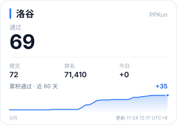
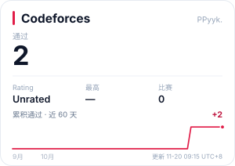
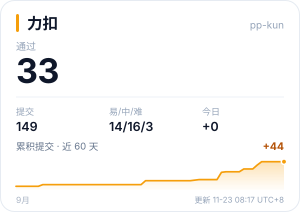

  

# 💫 Hi, I'm PPyyk (@PPKunOfficial)

### 🎓 CS Undergraduate @ GDUPT & Aspiring Full-Stack Developer
*Constantly learning, building, and exploring systems & web technologies.*

---

<!-- Tech Stack Badges -->
### 🛠️ Tech Stack & Tools

---

### 📊 GitHub Stats & Activity

<!-- Adaptive Theme Stats: Extended Cards -->

  <picture>
    <source
      srcset="https://github-stats-extended.vercel.app/api?username=PPKunOfficial&show_icons=true&include_all_commits=true&count_private=true&theme=dark_github&rank_icon=github&show=prs_merged_percentage,prs_reviewed"
      media="(prefers-color-scheme: dark)"
    />
    
  </picture>
  <picture>
    <source
      srcset="https://github-stats-extended.vercel.app/api/top-langs?username=ppkunofficial&layout=donut&theme=dark_github&hide=jupyter%20notebook&exclude_repo=2025-51MCMProblemC"
      media="(prefers-color-scheme: dark)"
    />
    
  </picture>

---

### 🧩 OJ

  <a href="assets/oj/luogu.svg">
    <picture>
      <source media="(prefers-color-scheme: dark)" srcset="assets/oj/luogu-dark.svg">
      
    </picture>
  </a>
  <a href="assets/oj/codeforces.svg">
    <picture>
      <source media="(prefers-color-scheme: dark)" srcset="assets/oj/codeforces-dark.svg">
      
    </picture>
  </a>
  <a href="assets/oj/leetcode.svg">
    <picture>
      <source media="(prefers-color-scheme: dark)" srcset="assets/oj/leetcode-dark.svg">
      
    </picture>
  </a>

  📈 近 60 天累积趋势 · 力扣按提交次数统计 · 05:00 为统计日分界 · 每日自动更新 · 深色模式自动适配

---

📌 <i>Public Repos have been pinned below!</i>

